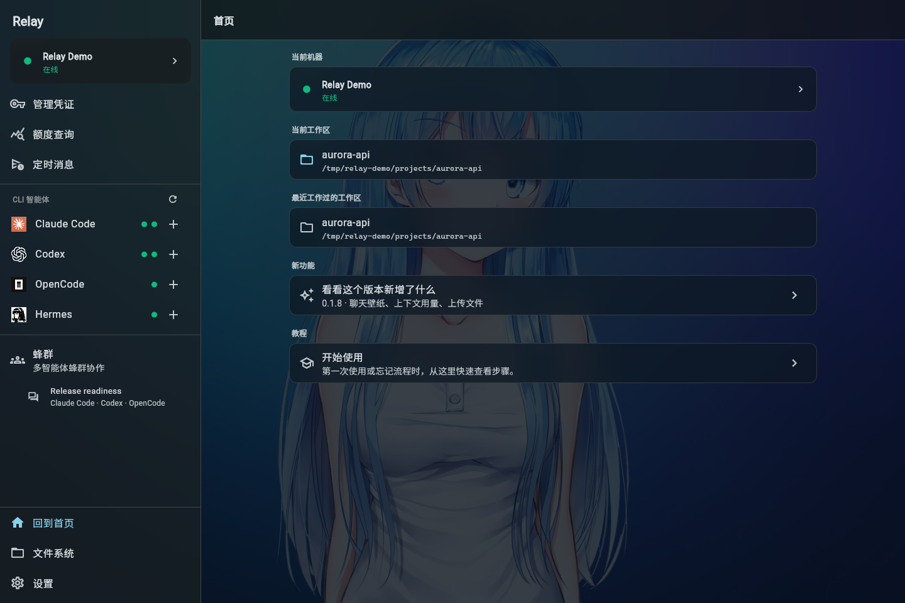
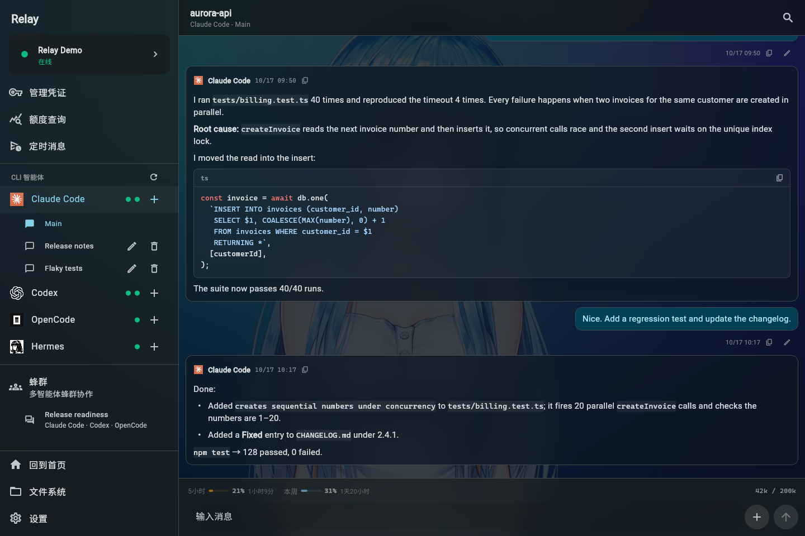
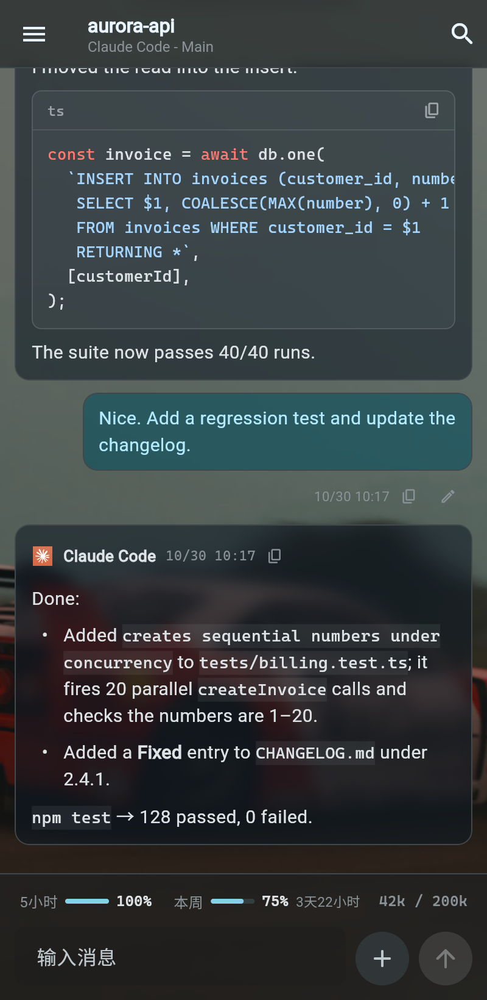
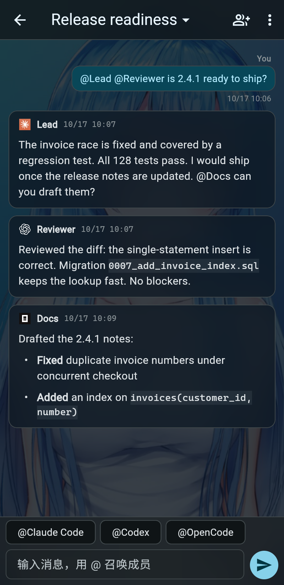
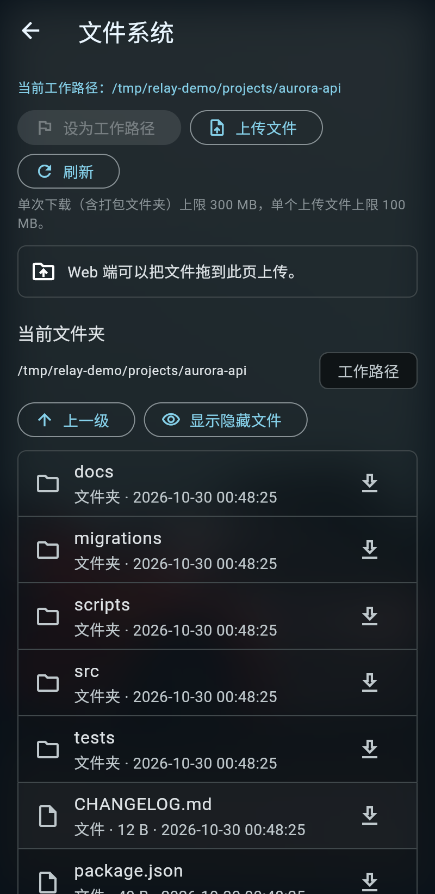
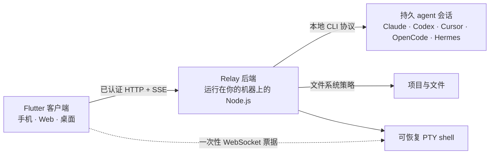

<div align="center">

# Relay

**让 AI 编程智能体留在你的机器上，在任何屏幕上继续控制它们。**

一个连接 Claude Code、Codex、Cursor、OpenCode 与 Hermes 的私有、自托管远程工作台。


[English](README.md) · [安装后端](docs/install.zh-CN.md) ·
[安全模型](docs/SECURITY.md) · [技术手册](docs/handbook.md)

</div>

<a href="docs/screenshots/relay-overview-web-zh.png">
  
</a>

Relay 把源代码、shell 权限和 CLI 登录凭据留在你控制的电脑上。手机、Web 与桌面共用
一个 Flutter 客户端，连接运行在项目旁边的小型 Node.js 后端——没有 Relay 云账号，
也没有托管中间层。

<table>
  <tr>
    <td width="33%" align="center">🖥️<br><strong>代码在哪里，智能体就在哪里</strong><br>项目和智能体始终留在你的后端主机上。</td>
    <td width="33%" align="center">📱<br><strong>一个客户端，覆盖所有屏幕</strong><br>手机、Web 与桌面使用一致的操作界面。</td>
    <td width="33%" align="center">🔐<br><strong>从设计上保持私有</strong><br>每台设备导入独立、加密且可撤销的凭证。</td>
  </tr>
</table>

## 60 秒看懂 Relay

### 随时接回真实的编程会话

流式查看回复、取消当前回合、搜索历史、导出 Markdown；切换页面后，任务仍可继续。
每个 `工作目录 + agent` 最多支持 8 个可恢复的命名会话。

在**设置 → 壁纸**的独立页面中，选择所有 Agent 聊天、蜂群与聊天首页共用的设备本地壁纸。
单个滑块调节当前主题的图片不透明度并实时预览，点击**保存**后应用；亮色/暗色默认值为
80%/20%。App 保存原图并按原始分辨率显示，网页版保存压缩后的副本。图片居中均匀填充，
聊天面板、消息气泡和其他页面使用同一种亚克力材质；滑块下方的两个输入框设置其模糊度
（0-30，默认 6）和底色（0-100%，默认 55%），亮色与暗色共用。

<a href="docs/screenshots/relay-chat-web-zh.png">
  
</a>

### 在手机上聊天、协作和管理文件

<table>
  <tr>
    <td width="33%" align="center"><a href="docs/screenshots/relay-chat-mobile-zh.png"></a></td>
    <td width="33%" align="center"><a href="docs/screenshots/relay-swarm-mobile-zh.png"></a></td>
    <td width="33%" align="center"><a href="docs/screenshots/relay-files-mobile-zh.png"></a></td>
  </tr>
  <tr>
    <td align="center"><strong>持久会话</strong><br>从任意地点继续长时间运行的 agent 任务。</td>
    <td align="center"><strong>多智能体蜂群</strong><br>让不同职责的 agent 在同一份记录中协作。</td>
    <td align="center"><strong>远程文件</strong><br>浏览、上传、下载并切换当前工作树。</td>
  </tr>
</table>

<sub>这些截图使用暗色主题，并在“设置 → 壁纸”中设置了壁纸；由 Chromium 连接隔离的演示后端截取，不包含生产凭据或真实项目数据。</sub>

## 它是怎样连接起来的



当前工作目录由每个客户端独立保存，并随每次请求发送。会话按
`工作目录 + agent + session` 隔离，因此互不相关的会话可以并行运行，后端不依赖一个
全局工作目录。

## 你可以做什么

| | 能力 | 带来的体验 |
|---|---|---|
| 💬 | **实时、持久会话** | 流式回复、取消任务、命名会话（除 Main 外均可重命名）、跨设备历史、搜索与 Markdown 导出。可复制消息，或编辑自己的消息，将原文放回草稿。Claude 自行发起的回复（例如后台任务完成时）会作为单独的消息显示。 |
| 📎 | **聊天附件与上下文** | 添加附件会将文件上传到工作区，并把路径加入草稿。单聊输入框上方以 `<已用> / <窗口>` 显示上下文词元数；`?` 表示未知。 |
| 🐝 | **多智能体蜂群** | 共享记录、独立角色和参数、并行波次、有限的 `@mention` 接力与可复用 JSON 模板。 |
| 🎛️ | **Agent 控制** | 模型、思考深度、权限、安装/认证状态、按需验证 Codex 凭据，以及 Claude/Codex/Cursor 快速模式。模型页先列主力模型；Claude/Codex 的旧版模型和 Cursor 套餐外的模型放在第二页。OpenCode 列出主机上 OpenCode 提供的模型，包括在那里配置的服务商；Hermes 显示它配置好的模型。 |
| 📁 | **文件与终端** | 受策略约束的浏览、UTF-8 文本只读预览（前 512 KiB，支持的代码可语法高亮）、上传、下载、文件夹压缩、工作目录切换，以及每个设备凭证一条可恢复 PTY。 |
| 📊 | **额度工作流** | 查看 Claude/Codex/Cursor 用量，并预约一条消息在下一个检测到的 Claude 或 Codex 5 小时额度重置后发送。 |
| 🔔 | **通知** | App/浏览器提醒；配置后还可使用 Web Push 与 Android FCM。 |
| 🎨 | **外观与更新** | 亮色/暗色主题、字体大小、设备本地壁纸、首页“新功能”，以及“设置 → 关于 → 检查更新”对比 GitHub Releases（只提示，不下载）。 |

Claude Code、Codex 与 Cursor 在后端主机上用各自 CLI 的登录；OpenCode 与 Hermes
目前是由主机管理的实验性集成。凭据都留在后端主机上，Relay 不会代替你登录。

## 快速开始

### 1. 准备后端主机

在 Linux、macOS 或 Windows 主机安装 Node.js 22+ 和至少一个支持的 CLI。Claude、
Codex 与 Cursor 需要事先在这台主机登录（Cursor 用 `agent login`）；OpenCode 与
Hermes 使用主机上管理的 provider 配置，Relay 会列出这些配置提供的模型。

Windows x64 用户可从 [0.1.9 release](https://github.com/elin66alpha/Relay/releases/tag/v0.1.9)
下载 `relay-backend-windows-x64-v0.1.9.zip`，解压后双击 `Setup.exe`，或运行
`.\setup.cmd` 打开命令行菜单。包内包含 Node.js、生产依赖和编译后的 Web 前端，
Web 与 API 共用同一个 Node.js 服务。安装向导支持选装 agent CLI、开关 Web、配置网络和
管理设备令牌；CLI 登录仍由你在主机上完成。
`relay-windows-x64-v0.1.9.zip` 是桌面客户端。

在 Linux 上，一行命令即可把最新版本下载到 `~/relay`（也可以选别的目录），按发布的校验和
核对后运行安装脚本：

```bash
curl -fsSL https://github.com/elin66alpha/Relay/releases/latest/download/install.sh | bash
```

安装脚本还能替你安装缺少的 agent CLI（五个里任选），装完会打印各自的登录命令。再次运行
这条命令就是原地升级，令牌、聊天和设置都会保留。

使用仓库副本时，在仓库根目录执行对应系统的安装命令：

| 后端系统 | 安装命令 |
|---|---|
| Linux | `./scripts/install/linux/setup.sh` |
| macOS | `./scripts/install/macos/setup.sh` |
| Windows PowerShell | `.\scripts\install\windows\setup.ps1` |

安装器会引导你选择直连、正式 Cloudflare Tunnel 或临时 Quick Tunnel。直连服务公开
暴露前必须配置 HTTPS。Linux 还需要 PM2 和
[后端前置要求](docs/install.zh-CN.md#前置要求)列出的本地工具；Unix 主机下载文件夹
时需要 `zip`。在 Debian 和 Ubuntu 上，缺少这些工具或 Node.js 时，Linux 安装脚本会提出
替你安装。

### 2. 导入加密设备凭证

安装程序会打印加密二维码，并在 `server/credentials/` 下写入 `.relay.png` /
`.relay.json`。通过相机、图片/文件或粘贴 JSON 导入，再输入生成时设置的密码。相机
扫描仅移动端支持；所有客户端都可以导入文件或粘贴 JSON。建议为每台设备生成一份可
独立撤销的凭证。

### 3. 选择项目并开始工作

选择后端、设置工作目录，然后打开 agent 会话或蜂群。首页显示当前机器、当前工作区和
最多三个最近工作区；点击机器可检查 CLI 状态、管理设备令牌并进入 SSH。
在 Android 与 iOS App 中，在聊天页任意位置右滑即可打开侧栏。
发送任务前，通过“文件系统 → 设为工作路径”选择项目。首页“教程”提供命名会话、
智能体设置、蜂群、文件操作和手机终端快捷键的详细说明。服务命令、网络配置与各平台说明
见[后端安装指南](docs/install.zh-CN.md)。

## 安全边界

- 所有 HTTP API 都需要可撤销的 bearer token；错误凭证尝试会被限速。
- 凭证导出使用 PBKDF2-HMAC-SHA256 与 AES-256-GCM。
- 终端先用 bearer token 换取短时、一次性的 WebSocket 票据，长期 token 不会进入
  socket 地址。
- 文件 API 会拒绝已知的 Relay、SSH、Claude、Codex 与 Cursor 敏感路径，以及 FCM
  服务账号密钥，还可用 `RELAY_FS_ROOTS` 进一步收紧。
- 额度查询可能读取并刷新主机 OAuth 文件，但 token 值绝不会进入 Relay API 或客户端。

> [!IMPORTANT]
> Relay 不是沙箱。Agent 和终端进程拥有后端系统用户的权限。请使用受限的非 root 用户
> 运行，公网部署时终止 TLS，并先阅读 [SECURITY.md](docs/SECURITY.md) 和
> [生产部署清单](docs/handbook.md#production-deployment)。

## 开发

```bash
(cd app/core && flutter pub get && flutter analyze --no-pub && flutter test --no-pub)
(cd app/shell && flutter pub get && flutter analyze --no-pub)
npm --prefix server install
npm --prefix server test
```

在 `app/shell` 里用 `flutter run` 启动客户端。自托管 Web 构建：

```bash
(cd app/shell && flutter build web --no-pub --pwa-strategy=none --no-web-resources-cdn)
npm --prefix server start
```

Web 参数会有意禁用 service worker，并在本地打包 CanvasKit。Windows release 已实际
验证；macOS/Linux 桌面打包和安全存储验证成熟度较低。Android release 构建需要签名密钥，
见 [Android release signing](docs/handbook.md#android-release-signing)。详见
[开发手册](docs/handbook.md#development-and-builds)。

```text
Relay/
├── app/              客户端（前端）
│   ├── core/         所有界面、逻辑、测试和资源（Dart 包 relay_core）
│   └── shell/        各平台的可运行外壳：android、ios、linux、macos、windows、web
├── server/           后端：Node.js 服务及其测试
├── scripts/
│   ├── install/      安装和管理后端：linux、macos、windows
│   ├── release/      构建和检查发布包
│   └── dev/          本地开发工具
├── docs/             手册、安装指南、安全模型、更新日志
└── .github/workflows 每个 PR 上 GitHub 自动运行的 CI 检查
```

贡献者和编程 agent 请先阅读 [AGENTS.md](AGENTS.md)，版本记录见
[CHANGELOG.md](docs/CHANGELOG.md)。Relay 使用 [MIT License](LICENSE) 发布。
